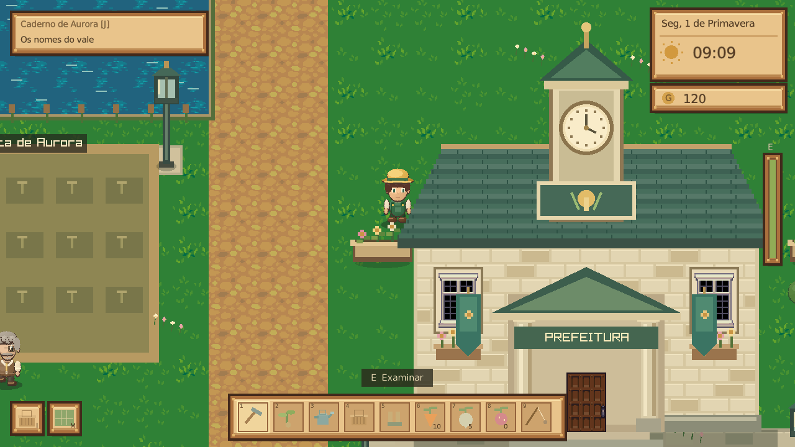
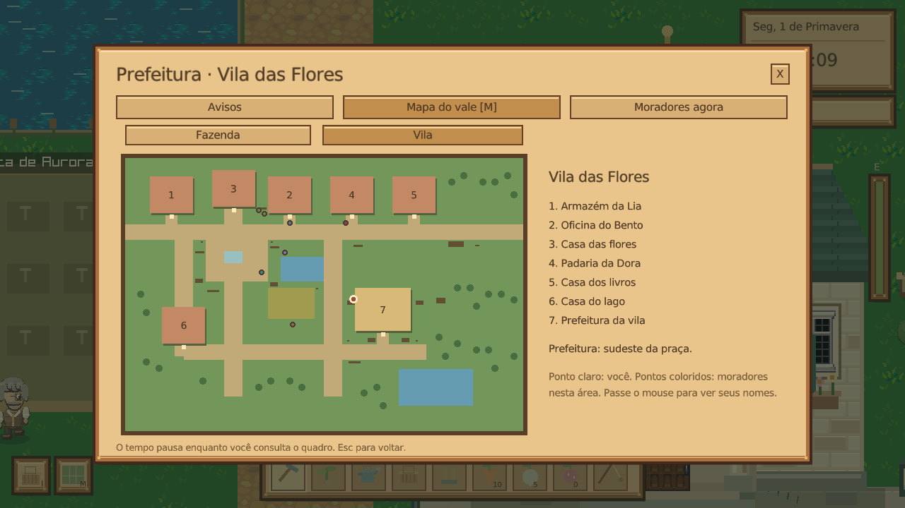

# Vale do Sol 🌱

RPG de fazenda para Linux, em **C# / .NET 10 / raylib**. A edição 8 renova a arte dos moradores, move a horta para fora da estrada e amplia a Vila das Flores com uma prefeitura, jardins e objetos com colisão.



**[Baixar o executável Linux 8.0.0](https://github.com/tomtelojk/asdsadsda/releases/download/v8.0.0/Vale-do-Sol-CSharp-8.0.0-Linux-x86_64)** · [Todos os downloads](https://github.com/tomtelojk/asdsadsda/releases/latest)

Permita execução nas propriedades do arquivo e abra. O `.tar.gz` contém o mesmo jogo, instruções e os arquivos de arte/licença LPC.

```sh
chmod +x Vale-do-Sol-CSharp-8.0.0-Linux-x86_64
./Vale-do-Sol-CSharp-8.0.0-Linux-x86_64
```

O .NET e a biblioteca gráfica estão incluídos. Requer Linux x86_64 com glibc 2.38+, X11/XWayland e OpenGL 3.3, como Ubuntu 24.04. Não precisa instalar SDK ou FUSE. Bibliotecas nativas são extraídas em `~/.net/` ao abrir pela primeira vez.

## Horta fora da estrada

A plantação fica **ao sul da estrada principal da fazenda**, com um caminho até o portão. São oito canteiros elevados de seis parcelas cada, separados por corredores. As 48 parcelas dos saves anteriores continuam com as mesmas plantas e estágios de crescimento.

Canteiros e cercas são sólidos: caminhe pelos corredores e entre pelos quatro portões. Todas as parcelas podem ser preparadas, plantadas, regadas e colhidas pela lateral. O desenho, a seleção de parcelas, as colisões e a navegação usam o mesmo modelo de horta.


Prepare a terra, plante cenouras, nabos e morangos, regue, durma e colha. Visite Lia para comprar sementes e vender produtos, melhore o regador com Bento e converse com Iara para ganhar uma vara de pesca. O fazendeiro é masculino.

## Uma vila para visitar

A prefeitura fica ao sudeste da praça, junto ao caminho para o lago. Ela tem uma fachada própria com torre de relógio e um interior acessível, com atendimento, arquivos e mesa de reunião. Otávio organiza os registros em algumas manhãs da semana; Dora e Ceci também incluem a prefeitura em suas visitas.

A vila ganhou bancos, floreiras, lampiões, um poço, uma banca, placas e um quadro de avisos. As bases desses objetos e o canteiro comunitário têm colisão. Árvores e copas são reservadas fora dos acessos, da horta e dos novos objetos.

Aproxime-se do quadro externo ou do painel da prefeitura e pressione **E**. Consulte os avisos, os lugares do vale e a localização atual dos moradores. **M** abre o mapa de qualquer área: alterne entre fazenda e vila, veja as construções e passe o mouse nos pontos dos moradores para identificar quem está ali. O mapa serve para orientação; os deslocamentos continuam pelos caminhos do jogo.



Há **oito interiores acessíveis**: sua casa, armazém, oficina, padaria, biblioteca, casa das flores, casa do lago e prefeitura. Examine os móveis com E. Portas, móveis e colisões vêm do mesmo modelo de mapa. O movimento usa a área dos pés, passos curtos e deslizamento junto a paredes; a navegação considera a largura do personagem.

## Moradores e nova arte

**Lia, Bento, Iara, Theo, Dora, Miguel, Ceci e Otávio** receberam novos retratos ilustrados, gerados para o projeto, com rostos, penteados e roupas distintos. Cada retrato é carregado como uma imagem completa, com proporção preservada. Os sprites de caminhada também ganharam detalhes para acompanhar os personagens.


Os moradores têm agendas próprias. Entram e saem pelas portas, visitam a fazenda e outros estabelecimentos, fazem refeições e encontram os vizinhos. Chuva, dias úteis e fins de semana mudam os destinos. Durante os compromissos, alternam tarefas de estoque, oficina, pesca, plantas, cozinha e leitura, com deslocamentos, pausas, poses e pequenos balões de conversa.

As posições e áreas são gravadas. A simulação continua quando o jogador está em outro lugar; menus e diálogos pausam o tempo. O menu **R** também oferece uma galeria de retratos ampliados. Ele e a aba **Moradores agora** do quadro mostram as atividades. Os diálogos têm assuntos de trabalho, vida pessoal, dia e história principal; clima, horário, estação e amizade influenciam as falas. O save lembra as últimas escolhas para evitar a mesma resposta consecutiva.

Os sprites do mundo mantêm filtro de ponto e pixels alinhados à câmera. Os retratos ilustrados usam filtragem própria para reduzir a imagem sem deformá-la. O modo padrão **Imagem: nítida** amplia a tela por fatores inteiros e pode deixar margens em monitores maiores. A pausa oferece **Imagem: preencher**, que permite escala fracionária.

## O Caderno das Estações

Você é o neto de Aurora e acaba de herdar a Fazenda Girassol. Junto da chave, ela deixou uma carta e um caderno incompleto sobre a antiga horta comunitária da vila. Otávio guardou uma página; os outros moradores guardaram suas próprias lembranças.

A campanha tem **seis capítulos**, com cultivo, materiais, pesca e amizades. Recupere as bancadas, forme um canteiro compartilhado e prepare uma mesa para reunir a vila. O diário **J** mostra objetivos, requisitos, contato e recompensas. Entregue os materiais perto do morador indicado; o último encontro acontece na vila entre 17h e 21h, em um dia posterior aos preparativos. Não há prazo para concluir os capítulos, e o jogo continua após o desfecho.

A carta pode ser relida pelo diário. Cada morador tem comentários sobre cada etapa no assunto **O caderno [U]**. Veja [a história e seus capítulos](docs/HISTORIA.md) para os detalhes, incluindo spoilers.

## Controles

| Ação | Controle |
| --- | --- |
| Caminhar / correr | WASD ou setas / Shift |
| Ferramentas / sementes / vara | 1–5 / 6–8 / 9 |
| Cultivar perto do personagem | Clique; Espaço usa o canteiro à frente |
| Caminhar até um ponto | Botão direito |
| Conversar, entrar, examinar, recolher, consultar quadro | E |
| Pescar / puxar na fisgada | F / Espaço |
| Mochila / diário / moradores | I ou Tab / J / R |
| Mapa do vale | M |
| Assuntos da conversa | Q / T / Y / U |
| Ajuda / pausa / salvar / tela cheia | H / Escape / F5 / F11 |

A estrada à direita da fazenda leva à vila; volte pela saída à esquerda. Dentro das casas, caminhe até a porta inferior para sair. Durma ao lado da cama da sua casa. O dia termina às 22h. Lia atende das 8h às 17h em dias úteis e até 13h nos fins de semana.

O jogo continua em desenvolvimento. Não há casamento, multiplayer ou música; referências a músicas nas falas fazem parte da história de Ceci. As três culturas crescem em todas as estações.

## Editar o projeto

```sh
./scripts/setup-dotnet.sh  # opcional: SDK local, sem sudo
./scripts/run.sh          # recompila e abre o jogo
./scripts/test.sh         # regras, história, física, arte, rotinas e saves
./scripts/package.sh      # executável Linux com runtime em release/
```

Abra `ValeDoSol.slnx` em uma IDE com suporte a C#/.NET 10. O primeiro build baixa raylib e verifica SHA-256. O SDK local tem SHA-512 verificado.

Em `src/ValeDoSol/`: `Garden.cs` define canteiros, corredores, cercas e parcelas; `Map.cs` define construções e móveis; `VillageProps.cs` e `TownArt.cs` definem os objetos da vila e seu desenho. `Physics.cs` cuida de colisão e navegação; `Social.cs` e `NpcBehavior.cs`, de agendas, falas e tarefas. `Story.cs` contém a campanha. `SpriteCatalog.cs`, `Scenery.cs`, `Art.cs` e `Portraits.cs` cuidam dos recortes e das artes. `Game.cs` controla as interações; `State.cs`, cultivo, economia e saves; `Ui.Civic.cs`, o quadro e o mapa. `Viewport.cs` mantém apresentação e mouse na mesma escala.

## Saves e validação

A pasta padrão é `~/.local/share/vale-do-sol-csharp/`, ou `$XDG_DATA_HOME/vale-do-sol-csharp/`. O arquivo principal é `save.json`; a mochila oferece backup/restauração em `backup.json`. Ao importar um save das edições 3–7, a edição 8 guarda o original em `save-before-v8.json`. As 48 plantas, recursos, amizades e o progresso da campanha existente são preservados. Personagens que estiverem numa nova área sólida são colocados num ponto livre próximo.

`--save-dir DIRETORIO` escolhe outra partida. `--self-test` verifica as regras sem display. `--smoke --scene TOWNHALL --screenshot imagem.png` abre uma área por 60 quadros e salva uma captura. Áreas disponíveis: `FARM`, `VILLAGE`, `HOME`, `SHOP`, `WORKSHOP`, `BAKERY`, `LIBRARY`, `GREENHOUSE`, `COTTAGE`, `TOWNHALL`. Os flags antigos `--village`, `--home` e `--shop` continuam disponíveis nos testes.

A suíte cobre cultivo e economia, história, migração de saves, arte, ferramentas, portas e colisões. Verifica que cada parcela fica fora das estradas e da água, é alcançável por um corredor e permite um ciclo de plantio, rega e colheita pela lateral. Também testa portões, cercas, a prefeitura e os objetos da vila. Os workflows abrem as dez áreas no Xvfb. Esses testes não cobrem todas as distribuições e GPUs.

## Créditos

Código e pixel art original dos personagens: MIT. Os novos retratos foram gerados para este projeto; seus arquivos e avisos ficam em [Resources/Characters](src/ValeDoSol/Resources/Characters). Cenários LPC: **Lanea Zimmerman (Sharm)**, [Liberated Pixel Cup](https://github.com/OpenGameArt/LiberatedPixelCup), **CC BY-SA 3.0**. Os PNGs originais, a procedência e os avisos estão em [Resources/Lpc](src/ValeDoSol/Resources/Lpc). As artes LPC mantêm sua licença, separada do código. raylib: zlib/libpng. Fonte DejaVu Sans: licença incluída. O executável apresenta os avisos com `--licenses`.
