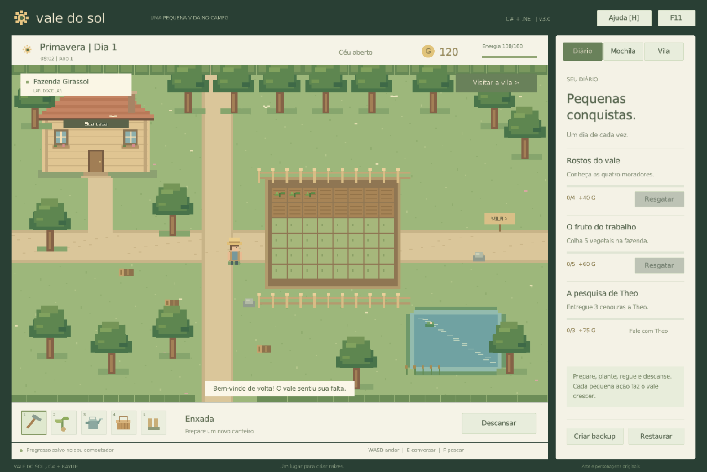

# Vale do Sol — C# 🌱

Jogo de fazenda para **Linux x86_64**, escrito em **C# com .NET 10**. A janela, a entrada de teclado/mouse e os gráficos usam raylib. A lógica do jogo, interface, navegação, NPCs e saves ficam em C#.

O projeto principal foi convertido: não usa HTML, JavaScript, navegador ou Electron. A edição anterior continua preservada na [versão 2.0](https://github.com/tomtelojk/asdsadsda/releases/tag/v2.0.0).

## Baixar e executar

Abra **[Releases](https://github.com/tomtelojk/asdsadsda/releases/latest)** e baixe `Vale-do-Sol-CSharp-3.0.0-Linux-x86_64` ou o `.tar.gz` equivalente.

Nas propriedades do executável, marque **Permitir executar como programa** e abra. Pelo terminal:

```sh
chmod +x Vale-do-Sol-CSharp-3.0.0-Linux-x86_64
./Vale-do-Sol-CSharp-3.0.0-Linux-x86_64
```

O arquivo individual já inclui o runtime .NET e a biblioteca gráfica. Não precisa instalar o SDK, Electron ou FUSE. Na primeira execução, o .NET extrai bibliotecas em `~/.net/`.

Requer **Linux x86_64 com glibc 2.38+**, sessão gráfica X11/XWayland e OpenGL 3.3 — por exemplo Ubuntu 24.04. Os pacotes são sem assinatura e não têm atualizador automático.



## O jogo

- Fazenda com 48 canteiros e três culturas: cenoura, nabo e morango.
- Enxada, plantio, rega, colheita, inventário e venda.
- Vila com Lia, Bento, Iara e Theo: diálogos, amizade e presentes.
- Loja de sementes, melhoria do regador e três missões.
- Pesca com tempo de reação, madeira e pedra para recolher.
- Dia/noite, chuva a cada quatro dias e calendário sazonal.
- Colisões e caminhada por clique com busca de caminho.
- Saves locais, backup/restauração e tela cheia.

É uma primeira edição nativa jogável. Ainda não há interiores, casamento, multiplayer ou música. As estações mudam no calendário a cada 28 dias, mas as três culturas atuais podem ser plantadas o ano todo.

## Controles

| Ação | Controle |
| --- | --- |
| Andar | WASD, setas ou clique no chão |
| Enxada, sementes, regador, cesta, explorar | 1–5 |
| Cultivar | Clique no canteiro; o personagem caminha até ele |
| Trocar a cultura | Mochila → Plantar |
| Conversar, recolher recursos e abrir portas/loja | E perto do alvo ou clique nele |
| Pescar | F perto do lago, Espaço na indicação AGORA |
| Trocar aba lateral | Tab |
| Salvar | F5 |
| Ajuda / fechar | H / Escape |
| Tela cheia | F11 |

Regue e descanse para as plantas crescerem. Colha com a cesta e venda para Lia. Fale com Iara para ganhar uma vara. Junte 8 madeiras e 60 G para Bento melhorar seu regador. Às 22h começa um novo dia. Diálogos e perda de foco pausam o relógio.

## Executar o código e ver as mudanças

Requer SDK **.NET 10**, `curl`, `tar` e as bibliotecas gráficas do Linux. Em Ubuntu 24.04, as bibliotecas são `libgl1`, `libx11-6`, `libxrandr2`, `libxi6`, `libxcursor1` e `libxinerama1`.

Se você ainda não tem o SDK, o instalador opcional usa uma pasta local do projeto, sem sudo:

```sh
./scripts/setup-dotnet.sh
```

Para compilar e jogar:

```sh
./scripts/run.sh
```

Edite os arquivos `.cs`, feche o jogo e execute o mesmo comando para testar suas mudanças. O primeiro build baixa raylib do repositório oficial e confere o SHA-256. O SDK local também tem seu SHA-512 conferido.

```sh
./scripts/test.sh       # build e testes das regras do jogo
./scripts/build.sh      # compila com avisos tratados como erros
./scripts/package.sh    # produz o executável Linux com runtime incluído
```

Os executáveis de distribuição ficam em `release/`. Dependências e SDK locais ficam em `vendor/` e `.tools/`, fora do Git. `ValeDoSol.slnx` pode ser aberto em uma IDE com suporte a C#/.NET 10.

## Organização

- `src/ValeDoSol/State.cs`: cultivo, inventário, amizade, missões, navegação e persistência.
- `src/ValeDoSol/Game.cs`: ciclo do jogo e controles.
- `src/ValeDoSol/World.cs`: desenho dos mapas e personagens.
- `src/ValeDoSol/Ui.cs`: menus, loja, diálogos e ferramentas.
- `src/ValeDoSol/Ray.cs`: interop explícito com as funções gráficas de raylib.
- `src/ValeDoSol/SelfTests.cs`: testes executáveis sem interface gráfica.
- `.github/workflows/`: verificação e geração dos pacotes Linux.

## Saves e backup

Pasta padrão: `~/.local/share/vale-do-sol-csharp/`. Se `XDG_DATA_HOME` estiver definido, usa `$XDG_DATA_HOME/vale-do-sol-csharp/`.

O arquivo principal é `save.json`. **Criar backup** grava `backup.json` na mesma pasta; **Restaurar** carrega esse backup. Para transferir entre computadores, copie o backup para a mesma pasta no destino. Um save principal inválido é preservado e não é sobrescrito automaticamente.

```sh
./ValeDoSol --save-dir /caminho/para/uma/nova/partida
```

Os saves da antiga edição de navegador/Electron não são importados automaticamente e permanecem intactos em seu armazenamento original.

## Validação

`--self-test` executa verificações de cultivo, clima, economia, amizade, missões, navegação e serialização. `--smoke` abre a janela, desenha 60 quadros, salva e encerra. `--village` pode ser combinado com o smoke test. Esses parâmetros também funcionam no executável distribuído.

```sh
./ValeDoSol --self-test
./ValeDoSol --smoke --save-dir /tmp/vale-teste
```

Os testes gráficos automatizados usam Xvfb; isso não substitui validação em todas as distribuições/GPU Linux.

Código e arte originais sob MIT. raylib: zlib/libpng. A fonte DejaVu Sans e sua licença são incluídas em `Resources/`. O executável também disponibiliza os avisos com `--licenses`.
