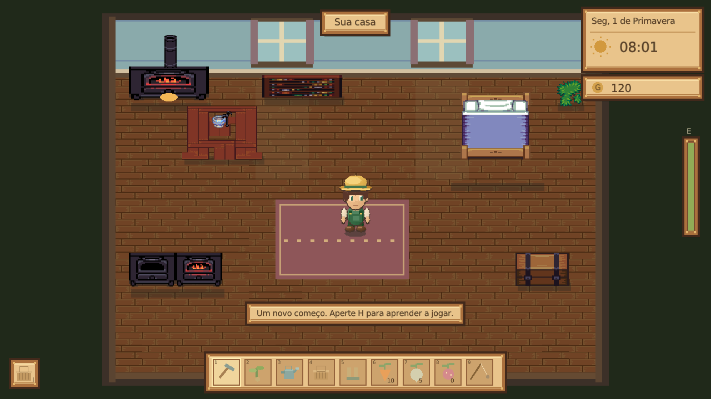
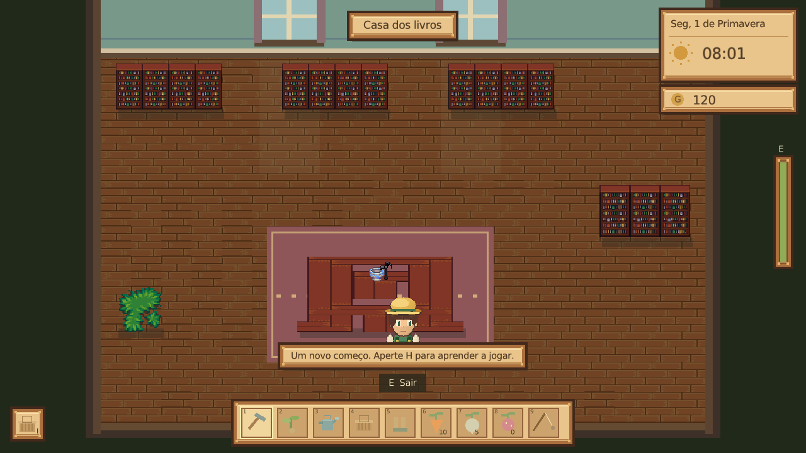
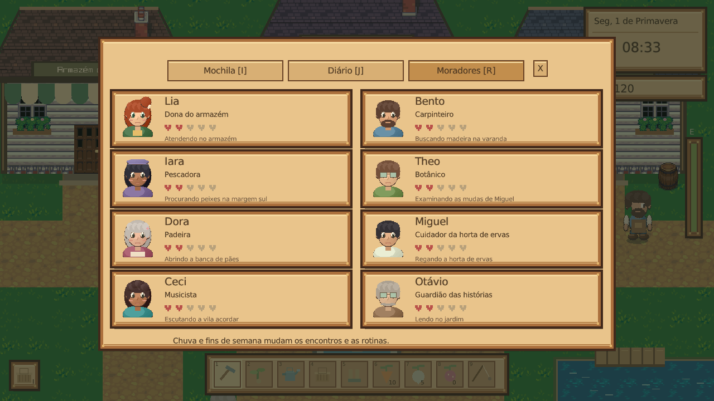

# Vale do Sol 🌱

RPG de fazenda para Linux, em **C# / .NET 10 / raylib**. A edição 6 reorganiza o mapa, corrige as colisões e troca os cenários simples por texturas de pixel art do **Liberated Pixel Cup**, com os créditos e a licença incluídos.


**[Baixar a versão atual](https://github.com/tomtelojk/asdsadsda/releases/latest)**

Baixe `Vale-do-Sol-CSharp-6.0.0-Linux-x86_64`, permita execução nas propriedades e abra. O `.tar.gz` contém o mesmo jogo, instruções e os arquivos de arte/licença LPC.

```sh
chmod +x Vale-do-Sol-CSharp-6.0.0-Linux-x86_64
./Vale-do-Sol-CSharp-6.0.0-Linux-x86_64
```

O .NET e a biblioteca gráfica estão incluídos. Requer Linux x86_64 com glibc 2.38+, X11/XWayland e OpenGL 3.3, como Ubuntu 24.04. Não precisa instalar SDK ou FUSE. Bibliotecas nativas são extraídas em `~/.net/` ao abrir pela primeira vez.

## Mapa e movimento

- Portas, dimensões das casas, móveis e colisões vêm do mesmo modelo de mapa.
- Árvores e suas copas são excluídas das estradas e acessos às casas.
- Colisão pela área dos pés, movimento em pequenos passos e deslizamento junto a paredes; a animação do corpo não determina a colisão.
- A busca de caminho considera a largura dos personagens, evita móveis e obstáculos e suaviza trechos livres.
- Casa do jogador, armazém, oficina, padaria, biblioteca, casa das flores e casa do lago têm interiores acessíveis, móveis e objetos que podem ser examinados.





## Moradores em movimento

Lia, Bento, Iara, Theo, Dora, Miguel, Ceci e Otávio têm **agendas próprias**, com horários e destinos distintos. Eles entram e saem pelas portas, fazem visitas, procuram outros pontos de pesca, cuidam de plantas e passeiam. Bento e Theo também visitam a fazenda.

Há pequenos deslocamentos durante as atividades, encontros na praça, planos para chuva e fins de semana. As posições e áreas dos moradores são gravadas: fechar e reabrir o jogo preserva o percurso em andamento. Os movimentos continuam sendo simulados quando o jogador está em outra área.


Os diálogos têm apresentação, assuntos escolhidos pelo jogador, falas conforme amizade/clima/horário e respostas pessoais a presentes. O menu R mostra a atividade atual. O tempo pausa nos menus e diálogos; feche-os para observar os moradores andando.



## Cultivar e jogar

Prepare a terra, plante cenouras, nabos e morangos, regue, durma e colha. Visite Lia para comprar sementes e vender produtos, melhore o regador com Bento e converse com Iara para ganhar uma vara de pesca. O fazendeiro é masculino.

| Ação | Controle |
| --- | --- |
| Caminhar / correr | WASD ou setas / Shift |
| Ferramentas / sementes / vara | 1–5 / 6–8 / 9 |
| Cultivar perto do personagem | Clique ou Espaço |
| Caminhar até um ponto | Botão direito |
| Conversar, entrar, examinar, recolher | E |
| Pescar / puxar na fisgada | F / Espaço |
| Mochila / diário / moradores | I ou Tab / J / R |
| Assuntos da conversa | Q / T / Y |
| Ajuda / pausa / salvar / tela cheia | H / Escape / F5 / F11 |

A estrada à direita da fazenda leva à vila; volte pela saída à esquerda da vila. Dentro das casas, caminhe até a porta inferior para sair. Durma ao lado da cama da sua casa. O dia termina às 22h. Lia trabalha no armazém até 17h em dias úteis e até 13h nos fins de semana; pode se deslocar dentro da loja enquanto atende.

Ainda é um jogo pequeno em desenvolvimento. Não há casamento, multiplayer ou música; referências a músicas nas falas fazem parte da história de Ceci. As culturas atuais crescem em todas as estações.

## Editar o projeto

```sh
./scripts/setup-dotnet.sh  # opcional: SDK local, sem sudo
./scripts/run.sh          # recompila e abre o jogo
./scripts/test.sh         # regras, física, interiores, rotinas e saves
./scripts/package.sh      # executável Linux com runtime em release/
```

Abra `ValeDoSol.slnx` em uma IDE com suporte a C#/.NET 10. O primeiro build baixa raylib e verifica SHA-256. O SDK local tem SHA-512 verificado.

Em `src/ValeDoSol/`: `Map.cs` define casas, estradas, vegetação e móveis; `Physics.cs` contém colisão e navegação; `Social.cs` define as agendas e falas; `Scenery.cs` monta os cenários com texturas LPC; `Art.cs` desenha os personagens originais; `Game.cs` controla os atores e as interações. `State.cs` cuida de cultivo, economia e saves.

## Saves e validação

A pasta padrão é `~/.local/share/vale-do-sol-csharp/`, ou `$XDG_DATA_HOME/vale-do-sol-csharp/`. O arquivo principal é `save.json`. A mochila oferece backup/restauração em `backup.json`. Antes de importar um save das edições 3–5, a edição 6 guarda o arquivo original em `save-before-v6.json`. Se uma construção ocupar a posição anterior, o jogador é colocado em um ponto livre próximo.

`--save-dir DIRETORIO` escolhe outra partida. `--self-test` verifica as regras sem display. `--smoke --scene BAKERY --screenshot imagem.png` abre uma área por 60 quadros e salva uma captura. Os nomes das áreas são `FARM`, `VILLAGE`, `HOME`, `SHOP`, `WORKSHOP`, `BAKERY`, `LIBRARY`, `GREENHOUSE`, `COTTAGE`. Os flags antigos `--village`, `--home` e `--shop` continuam disponíveis nos testes.

A validação inclui trajetos para todas as casas e móveis, verificação de copas fora das estradas, colisão em movimentos rápidos/diagonais e uma simulação dos oito moradores por um dia, incluindo deslocamentos entre áreas e persistência ao reabrir. Os workflows também abrem todas as áreas no Xvfb. Isso não substitui testes em todas as distribuições/GPU.

## Créditos

Código e personagens originais: MIT. Cenários LPC: **Lanea Zimmerman (Sharm)**, [Liberated Pixel Cup](https://github.com/OpenGameArt/LiberatedPixelCup), **CC BY-SA 3.0**. Os PNGs originais, os caminhos de origem e os avisos estão em [Resources/Lpc](src/ValeDoSol/Resources/Lpc). As artes LPC mantêm sua própria licença, separada do código. raylib: zlib/libpng. Fonte DejaVu Sans: licença incluída. O executável apresenta os avisos com `--licenses`.
