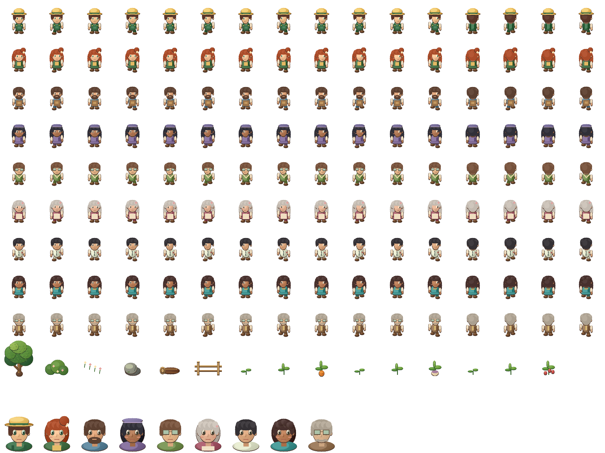

# Arte e personagens

A imagem enviada pelo jogador orientou as cores e o desenho dos personagens. Os personagens são desenhados em `src/ValeDoSol/Art.cs`; o jogo não extrai os personagens da imagem de referência. O fazendeiro é masculino.

O atlas original mede 2048 × 1536 pixels, com 16 colunas e 12 linhas de células de 128 × 128. Cada célula reserva dois pixels transparentes nas bordas para evitar partes de quadros vizinhos. Os retratos foram ajustados para que ombros e roupas caibam nas células.

- Células 0–15: fazendeiro masculino.
- Células 16–143: Lia, Bento, Iara, Theo, Dora, Miguel, Ceci e Otávio; 16 quadros por personagem.
- Cada conjunto de 16 quadros tem quatro direções: baixo, esquerda, direita e costas, com quatro quadros por direção.
- Células 144–149: árvore, arbusto, flores, pedra, tronco e cerca.
- Células 150–158: três estágios de cenoura, nabo e morango.
- Células 176–184: retratos do fazendeiro e dos oito moradores.

Os índices começam em zero. As células restantes são reservadas. `--export-art arquivo.png` exporta o atlas para inspeção; editar a imagem exportada não altera o jogo, pois a fonte desses desenhos é `Art.cs`.

## Recortes e escala na edição 7

`SpriteCatalog.cs` registra os retângulos completos dos objetos LPC e o ponto de base de cada um. Camas, estantes, baús, portas, janelas, chaminés, árvores e utensílios usam esses recortes em vez de tratar todos os objetos como quadrados. O desenho preserva a proporção da fonte. Móveis largos são compostos por peças inteiras, e seus limites de colisão acompanham as dimensões do objeto.

Os personagens usam escala de 0,5 no mundo e câmera de 2: cada pixel de origem ocupa um pixel no alvo de 1280 × 720. A posição dos sprites e a câmera são alinhadas a essa grade, e o filtro de textura é de ponto. Isso evita a redução fracionária anterior, que descartava detalhes de forma irregular durante o movimento.

A apresentação final usa o mesmo retângulo para desenhar e interpretar o mouse. No modo padrão **Imagem: nítida**, janelas grandes usam ampliação inteira e margens quando necessário. Por exemplo, uma janela de 1920 × 1080 apresenta o alvo em 1280 × 720 centralizado. O modo **Imagem: preencher**, disponível na pausa, permite a escala de 1,5 nesse exemplo. Janelas menores que o alvo precisam de redução uniforme.

A [auditoria de arte](ART-AUDIT.md) registra os problemas encontrados e as medidas de origem. Os PNGs LPC permanecem como arquivos originais; as correções estão nos recortes, na composição e na apresentação do jogo.

## Cenário, profundidade e moradores

Construções, chão, água, árvores e interiores usam os PNGs originais do Liberated Pixel Cup, por **Lanea Zimmerman (Sharm)**, sob **CC BY-SA 3.0**. Os arquivos, a procedência e a licença estão em `Resources/Lpc`. O código MIT e os desenhos originais dos personagens mantêm suas licenças separadas.

`Map.cs` define casas, estradas, áreas dos móveis e colisões. `Physics.cs` usa a área dos pés e passos curtos, e a navegação considera a largura do personagem. A ordenação por profundidade usa a posição dos pés e a base dos objetos. Árvores que ocultariam o jogador ficam translúcidas. A história deixa mudanças visíveis nas bancadas e na horta comunitária.

As agendas e falas ficam em `Social.cs`; `NpcBehavior.cs` define percursos curtos de trabalho, pausas e poses. Estoque, oficina, pesca, plantas, fornadas e leitura têm movimentos próprios. Balões curtos e objetos de atividade complementam as animações de caminhada. Ao reabrir a partida, as posições e áreas dos moradores são preservadas, assim como amizades, presentes e as últimas escolhas de conversa.

Para acrescentar arte ao projeto, use PNGs transparentes com dimensões e licença conhecidas. Mantenha o ponto dos pés alinhado entre os quadros de animação e registre os novos recortes no catálogo antes de colocá-los no cenário.
